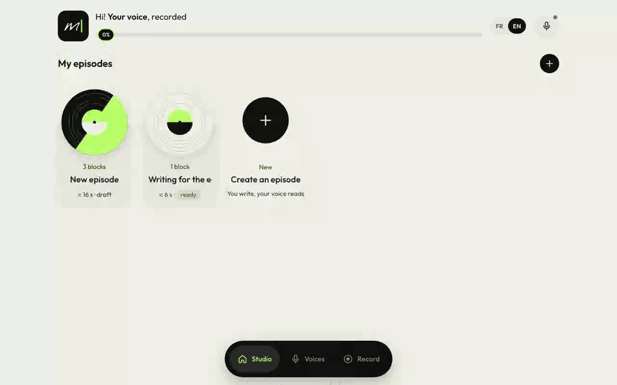
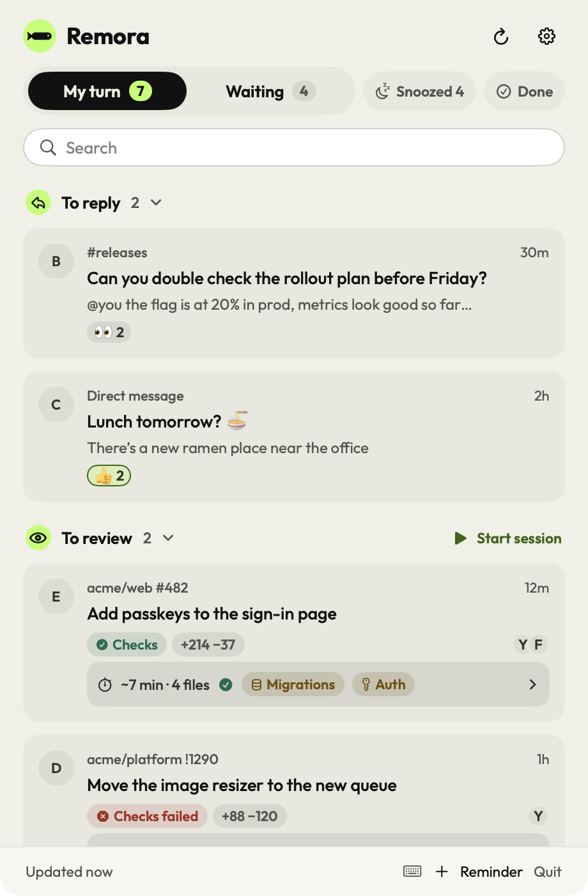

Hi, I'm Sebastien, Engineering Manager at [@hero-payments](https://github.com/hero-payments) in Paris. Hands-on: I still write code most days.

What I'm building on the side:

<table>
<tr>
<td width="50%" valign="top">

**[Myna](https://podcast.iscor.me)**: you write, Myna says it in your voice. It turns scripts into finished podcast episodes. The voice model runs in the browser, and you can train your own voice on your laptop from under an hour of recordings. Cloning only starts after a recorded consent sentence that Whisper checks. PyTorch, Piper, Whisper, ONNX Runtime Web, React, Swift, Tauri.

</td>
<td width="50%" valign="top">

<a href="https://github.com/iGitScor/triage"><picture><source media="(prefers-color-scheme: dark)" srcset="assets/remora-dark.png"></picture></a>

**[Remora](https://github.com/iGitScor/triage)**: my review queue. MRs, code reviews, Slack and Linear in one menu-bar list. Mac, Windows, Linux.

</td>
</tr>
</table>

Older stuff people still use: [cypress-recorder](https://github.com/iGitScor/cypress-recorder), [webpack-content-replacer-plugin](https://github.com/iGitScor/webpack-content-replacer-plugin).

[iscor.me](https://iscor.me) · [CV](https://cv.iscor.me)
